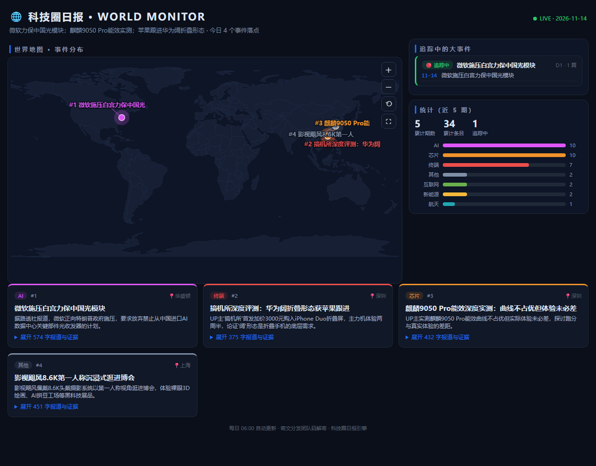

<div align="center">

# 🌏 科技圈日报 TechDaily

**AI 每天替你看完 B站科技区 + Hacker News + GitHub，
出一份有证据、有定位、能追踪到大结局的长文日报。**

[](https://github.com/bornfordreams/techdaily/releases)
[](https://github.com/bornfordreams/techdaily/releases)
[](#-服务器自建)
[](API.md)
[]()

**零游戏 · 零标题党 · 事件不重报 · 每条 300-500 字带证据**

</div>

---



> 每天一张世界地图大屏：事件按真实经纬度落点（AI 从报道内容自动定位），
> 大事件自动追踪到结局，支持缩放/平移/全屏。

## ✨ 它和别的"AI 日报"有什么不同

| | 别人 | TechDaily |
|---|---|---|
| 看内容方式 | 抓标题和摘要 | **真下载视频抽帧看片** + HN/GitHub 全文 |
| 证据 | 一句话结论 | 画面里截到的价格/份额/日期全列在证据栏 |
| 旧闻 | 天天重复推 | **事件级去重**，重大新进展才准再上榜 |
| 游戏/八卦 | 混着推 | **五道内容闸**全拦（含游戏产业新闻，无例外） |
| 追踪 | 报完就忘 | **大事件故事线**自动跟到结局（D1→D2→…→✅完结） |
| 隐私 | 明文分发 | 全链路 **AES-256-GCM 密文**，团队码即密钥 |
| 追问 | 不能问 | 每条可 **🤖问AI**，AI 带着该事件全部历史回答 |

## 🚀 三分钟上手

**订阅者（装机即用）**
1. 下载 [Releases](https://github.com/bornfordreams/techdaily/releases) 里的 `接收端安装包`（或单独下 exe/APK）
2. 首次打开，填两样：**服务器地址 + 团队码**（向创建者索取）
3. 完事——每天 06:00 自动更新，双击/点开即读

**自建者（一台 Windows 开站）**
- 小白路线：下载 `techdaily-server-setup.exe`，双击 → **填 3 格**（GLM APIKEY / Gitee 令牌 / 仓库地址）→ 一键部署，团队码自动生成
- 极客路线：克隆本仓库，按 [部署指南](部署指南.md) 走（纯 Python，支持 OpenAI/Anthropic 多格式 Key）

## 🔍 每天发生了什么

```
06:00  B站全站爬取(热门+24关键词) + HackerNews + IT之家 + GitHub Trending
  ↓    屏蔽词12连杀 → GLM精筛(宁多勿漏·游戏全禁) → UP主粉丝档位优先
  ↓    下载视频 → 抽8帧 → GLM视觉理解写长文(画面+字幕, 300-500字)
  ↓    成刊(事件级去重) → 推送前AI终审(游戏/重复/编造嫌疑, 点名即撤)
  ↓    大事件开故事线 → 世界地图定位 → 看板生成
  ↓    AES-256-GCM 加密 → 推送 Gitee 公网中转 → 全平台接收端
```

## 📦 交付物全家福

| 文件 | 给谁 |
|---|---|
| `techdaily-clients.zip` | 订阅者（exe + APK + 教程 + API 文档） |
| `techdaily-server-setup.exe` | 想一键开站的（3 格部署，零 Python 依赖） |
| `techdaily-server.zip` | 想读源码自己改的 |
| [使用教程](使用教程.md) · [部署指南](部署指南.md) · [API.md](API.md)（自写客户端指南） | 所有人 |

## 🛡️ 隐私与安全

接收端纯只读（不发评论、不@、不登录B站、零凭证内嵌）；
发布包经 12 项敏感信息强制扫描（APIKEY/令牌/团队码/地址，命中即中止）；
公网中转只见密文——路人 clone 你的仓库也只是一堆乱码。

## License

MIT
